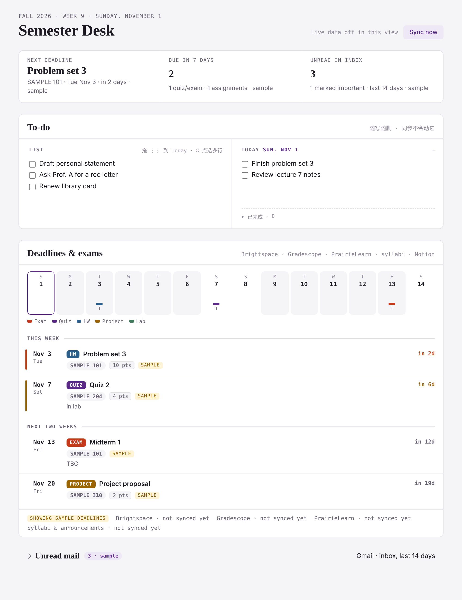

# Semester Desk

A one-page dashboard for college students that pulls every deadline, quiz and exam from your course sites into one place — and keeps a notes-style to-do list next to it.

Built as a [Claude](https://claude.ai) artifact: the page runs inside Claude, reads your Gmail / Notion through Claude's connectors, and a Claude scheduled task syncs your course sites once a day.



[中文说明在下面](#中文说明)

## Features

- **All deadlines in one list**: Brightspace, Gradescope, PrairieLearn, plus quiz/exam dates from your syllabi. Duplicates across sources are merged.
- **14-day strip**: one colored bar per item (exam / quiz / HW / project / lab), so busy days stand out.
- **Status at a glance**: submitted / graded (with score) / not submitted, a countdown, and a red or orange bar when something is due within 3 or 7 days.
- **Per-item study to-dos**, with optional suggestions that only come from material that actually exists on your course sites.
- **To-do panel**: a free-form *List* and a *Today* column. Drag lines (or ⌘-click several) into Today, tick them off, and finished items fold into a dated "已完成 / Done" history.
- **Unread mail** (collapsed) from Gmail.
- **Sync**: a daily scheduled task, plus a *Sync now* button. Submission receipts in Gmail are used as a backup when a site doesn't show your submission.

## How it works

```
course sites ──(your signed-in browser, read-only scripts)──► Claude scheduled task ──► artifact database
Gmail / Notion ──(Claude connectors, read-only)───────────────────────────────────────► the page
```

- `index.html` — the page. It reads the artifact database (`sources/*`, `desk/memo`, `todos/*`) and calls the Gmail and Notion connectors.
- `sync/*.js` — scripts the scheduled task runs inside each course site, using the session you are already signed in with. They only read.
- `sync/sync-task-prompt.md` — the prompt for the scheduled task.

## Setup

You need a Claude plan with artifacts, connectors and scheduled tasks, and the Claude desktop app (the sync uses Claude's built-in browser on your computer).

1. **Edit `CONFIG`** at the top of the `<script>` in `index.html`: term name, first Monday of the term, your course codes (up to 4 get colors), optionally a Notion page id.
2. **Publish the page** — ask Claude: *"Publish index.html as an artifact with these capabilities"*:
   ```json
   {
     "db":  { "rules": [{ "path": "", "write": "admin" }] },
     "mcp": { "servers": [
       { "server": "Gmail",              "tools": ["search_threads"] },
       { "server": "Notion",             "tools": ["notion-fetch"] },
       { "server": "Claude Code Remote", "tools": ["fire_trigger"] }
     ] }
   }
   ```
   Drop the Notion entry if you don't use it. Connect Gmail (and Notion) in Claude's connector settings.
3. **Sign in to your course sites** once in Claude's built-in browser (in the desktop app). The sync never types passwords; if a site is signed out it reports "sign-in needed".
4. **Create the scheduled task** from `sync/sync-task-prompt.md` (fill in your artifact link and school URLs, paste the scripts), set it to run daily on your computer, and put its id (`trig_…`) into `CONFIG.syncTaskId` so *Sync now* works. Republish the page.
5. Open the page in Claude. Until the first sync it shows clearly labeled sample data.

### Adapting to your school

- Brightspace: change the URL, and `COURSE_RE` in `sync/brightspace.js` if your course codes look different.
- PrairieLearn: the course-code regex at the top of the loop assumes CS courses; adjust as needed.
- Other systems (Canvas, Moodle…): write a script that returns `{courses, items}` with items shaped like
  `{source, course, name, due (ISO), kind: "assignment"|"quiz"|"exam", status, note, url}` and add it to the prompt.
- Notion (optional): the parser reads tables under `## COURSE-CODE …` headings whose cells contain dates like `10/14`.

## Notes and responsible use

- **Personal, read-only use.** The scripts read pages you can already see when signed in; they don't submit, change or download anything, and never handle your password. Check your school's IT policy and each platform's terms before automating access to them.
- **Your data stays in your account.** Synced items and to-dos live in your artifact's private database. Don't commit exports of it (the `.gitignore` excludes `*.json`).
- Dates and statuses are only as accurate as the source pages and the last sync — always double-check the original site before a deadline.
- Not affiliated with Anthropic, D2L/Brightspace, Gradescope (Turnitin) or PrairieLearn.

## License

MIT — see [LICENSE](LICENSE).

---

## 中文说明

**Semester Desk** 把 Brightspace、Gradescope、PrairieLearn 和 syllabus 里的作业、quiz、考试汇总到一页，旁边还有一个像备忘录一样的 To-do。它是一个 Claude 看板：页面在 Claude 里打开，通过 Claude 的连接读 Gmail 和 Notion，每天由一个 Claude 定时任务同步课程网站。

**主要功能**

- 所有 ddl 一个列表，多平台重复的会自动合并
- 未来 14 天色条，一眼看出哪天最忙
- 显示交没交、出分没有，3 天内截止标红、7 天内标橙
- 每条任务下可以加复习 todo，灰字建议只来自平台上真实存在的材料
- To-do：左边 List 随写随删，拖进右边 Today（⌘ 点选可多行一起拖），打勾后按日期收进「已完成」
- 折叠的未读邮件
- 每天自动同步一次，也可以点 Sync now；网站没显示已交时，会用邮件里的提交回执补上

**搭建步骤**

1. 改 `index.html` 里 `<script>` 开头的 `CONFIG`：学期名、第一周周一、你的课程代码（前 4 门有颜色）、Notion 页面 id（可选）
2. 让 Claude 把 `index.html` 发布成看板，权限按上面英文部分的 JSON 设置，并在 Claude 里连上 Gmail（和 Notion）
3. 在 Claude 桌面 app 的内置浏览器里登录一次各个课程网站（同步不会帮你输密码，退出登录了会提示 sign-in needed）
4. 按 `sync/sync-task-prompt.md` 建一个每天运行的定时任务，把任务 id 填进 `CONFIG.syncTaskId`，重新发布
5. 第一次同步前，页面显示的是标注了 sample 的示例数据

**使用须知**：仅供个人、只读使用；脚本只读取你登录后本来就能看到的页面，不提交、不修改、不处理密码。使用前请确认学校 IT 政策和各平台条款。同步数据存在你自己账号下看板的私有数据库里，不要把导出的数据传到仓库。截止日期请以原网站为准。与 Anthropic、D2L/Brightspace、Gradescope、PrairieLearn 均无关联。
